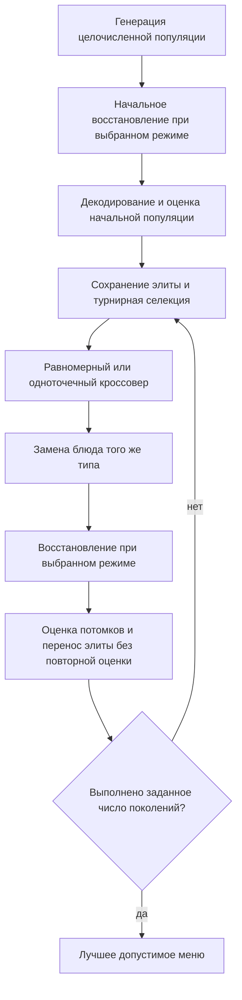
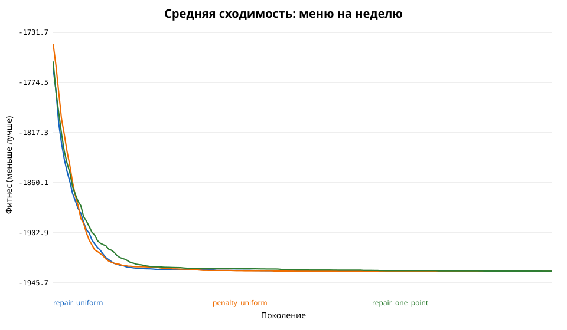

# Отчёт по лабораторной работе №2

Группа **517**, номер в списке **18**, вариант **20**. Разделы 1–10 соответствуют пунктам 1.4 методических указаний.

## 1. Постановка задачи и индивидуальный вариант

Вариант вычислен как `1+((17·18+7·1+26) mod 20)=20`. Требуется сформировать меню на семь дней с ограничениями калорийности, стоимости и разнообразия. Цель: максимизировать суммарную оценку выбранных блюд.

Подготовлены 36 синтетических блюд, по 12 для завтрака, обеда и ужина; `seed=20180517`. Калории/стоимость генерируются равномерно: завтрак 430–600/90–160, обед 650–850/140–250, ужин 550–750/120–220. Оценка блюда лежит в диапазоне 55–100. Это учебные условные данные, а не рекомендации по питанию. [Таблица блюд](../data/dishes.csv), [параметры задачи](../data/config.json).

## 2. Пространство решений, цель и ограничения

Решение `x=(x₀,…,x₂₀)` содержит целые индексы блюд. Допустимый тип задан позицией: `x₃d∈{0,…,11}`, `x₃d₊₁∈{12,…,23}`, `x₃d₊₂∈{24,…,35}`, где `d=0,…,6`. До предметных ограничений существует `12²¹` комбинаций.

Для блюда j заданы калории `kⱼ`, стоимость `cⱼ`, оценка `uⱼ`. Максимизируется `U(x)=Σᵢu[xᵢ]` при ограничениях:

- для каждого дня `1700 ≤ Σₘ₌₀² k[x₃d₊ₘ] ≤ 2200`;
- недельная стоимость `C(x)=Σᵢc[xᵢ] ≤ 3800`;
- число различных индексов `|{xᵢ}| ≥ 15`;
- число использований каждого блюда `count(j) ≤ 2`.

Минимизируется `F(x)=−U(x)+1000·Δкал+1000·Δбюджет+3000·(Δразнообразие+Δповторы)`. Отклонения неотрицательны; при допустимом меню `F=−U`. Поэтому **−1936 лучше −1935**. Максимальный возможный разброс U не превышает `21·(100−55)=945`; минимальный ненулевой штраф 1000 делает любое нарушение дороже выигрыша полезности.

## 3. Представление особи: генотип, фенотип, декодирование

**Генотип**: список из 21 целого индекса, с которым работают селекция, кроссовер и мутация. **Фенотип**: недельное меню с названиями блюд, калориями и стоимостью. В отличие от ЛР1, они представлены по-разному: индексы требуют декодирования через таблицу блюд.

Для позиции i день равен `i//3`, приём пищи равен `i%3`; строка `dishes[xᵢ]` даёт предметные свойства. Например, начало лучшего генотипа `[9, 16, 33]` декодируется так:

| Позиция i | Ген xᵢ | Приём пищи в понедельник | Блюдо | Ккал |
|---|---:|---|---|---:|
| 0 | 9 | завтрак | Завтрак 10 | 438 |
| 1 | 16 | обед | Обед 05 | 725 |
| 2 | 33 | ужин | Ужин 10 | 708 |

Это взаимно однозначное соответствие слотов и записей меню. Полный фенотип приведён в разделе 10 и [best_menu.csv](best_menu.csv). Два допустимых и два недопустимых примера с величинами нарушений находятся в [feasibility_examples.csv](feasibility_examples.csv).

## 4. Алгоритм, операторы и параметры

| Параметр | Значение |
|---|---|
| Популяция / инициализация | 80 / случайное блюдо допустимого типа в каждом слоте |
| Отбор | Турнир размера 3 |
| Кроссовер | Равномерный или одноточечный; вероятность 0.9 |
| Мутация | Применяется с вероятностью 0.25; внутри неё каждый слот заменяется с вероятностью 0.08 |
| Элитизм | 1 лучшая особь, без повторной фитнес-оценки |
| Ограничения | Восстановление допустимости или штраф |
| Остановка | 180 поколений; 14300 фитнес-оценок |

Восстановление уменьшает нарушения через замены блюд: до 500 локальных попыток с вероятностью 0.1 принять ухудшение. Затем допустимы до 100000 попыток случайной генерации. При неуспехе выдаётся ошибка. Оператор не использует полезность при исправлении и не гарантирует нахождение меню для любого произвольного экземпляра. Штрафной подход не исправляет кандидата и учитывает нарушения в F. [Полная таблица параметров](parameters.csv).

## 5. Блок-схема алгоритма

## 6. Обоснование операторов относительно структуры меню

| Оператор | Почему выбран | Что сохраняет и что может нарушить |
|---|---|---|
| Турнир 3 | Сравнивает F напрямую, включая отрицательные значения и штрафы; масштабирование не нужно | Предпочитает лучшие меню, но сам не создаёт разнообразие |
| Равномерный кроссовер | Независимо комбинирует блюда в одинаковых слотах родителей | Сохраняет тип приёма пищи, но может нарушить бюджет, калории и разнообразие |
| Одноточечный кроссовер | Сохраняет непрерывные фрагменты недельного меню | Сохраняет тип слота; граница может пройти внутри дня, допустимость всех ограничений не гарантируется |
| Замена блюда того же типа | Даёт содержательную дискретную мутацию и позволяет менять любой слот | Не создаёт ужин на месте завтрака, но остальные ограничения нужно проверять |
| Восстановление | Возвращает кандидата в допустимую область, когда удаётся исправить ограничения | Требует дополнительных проверок и может менять полезные сочетания блюд |
| Штраф | Позволяет проходить через недопустимые промежуточные решения без отдельного ремонта | Допустимость обеспечивается оценкой и проверкой финала, а не самим кроссовером |
| Элитизм | Защищает лучший уже найденный вариант от потери при вариации | Лучшее F в серии поколений не ухудшается |

Это обоснование свойств операторов. Их фактическое влияние оценивается сравнением серий ниже; преимущество оператора заранее не предполагается.

## 7. Схема эксперимента и независимые запуски

Выполнено 20 запусков каждой из четырёх конфигураций: всего 80. Фиксированные seed ГА начинаются с 2000000, 2010000, 2020000; случайного поиска с 2900000. Внутри каждой серии seed увеличивается на 1. Все методы работают с одними данными.

Контролируемые сравнения: `repair_uniform` против `penalty_uniform` меняет только обработку ограничений; `repair_uniform` против `repair_one_point` меняет только кроссовер. Число обучающих оценок каждого метода одинаково: `80+180·79=14300`. Случайный поиск генерирует столько же кандидатов и выбирает лучший допустимый. Восстановление выполняет дополнительные проверки ограничений; они входят во время, но не считаются вызовами целевой фитнес-функции. Поэтому равенство фитнес-бюджета не означает равенства времени работы.

## 8. Статистика и график результатов

В таблице приведён минимизируемый фитнес финальных решений; стандартное отклонение выборочное, по 20 независимым запускам. Доля допустимости относится к **финальному решению каждого запуска**, а не ко всем особям популяции.

| Метод | Лучший фитнес | Средний | Медиана | Ст. отклонение | Худший | Лучшая полезность | Допустимые запуски |
|---|---:|---:|---:|---:|---:|---:|---:|
| repair_uniform | -1936 | -1935.9 | -1936 | 0.30779351 | -1935 | 1936 | 100% |
| penalty_uniform | -1936 | -1935.95 | -1936 | 0.2236068 | -1935 | 1936 | 100% |
| repair_one_point | -1936 | -1935.9 | -1936 | 0.30779351 | -1935 | 1936 | 100% |
| random_feasible_search | -1872 | -1830.95 | -1825 | 16.715814 | -1808 | 1872 | 100% |

| Метод | Средняя полезность допустимых меню | Среднее время, с | Фитнес-оценок | Запусков с доказанным оптимумом |
|---|---:|---:|---:|---:|
| repair_uniform | 1935.90 | 0.3804 | 14300 | 90% |
| penalty_uniform | 1935.95 | 0.1257 | 14300 | 95% |
| repair_one_point | 1935.90 | 0.3347 | 14300 | 90% |
| random_feasible_search | 1830.95 | 0.1110 | 14300 | 0% |

Время измерено на машине выполнения серии, включает восстановление и зависит от оборудования. Полные результаты: [runs.csv](runs.csv), агрегаты: [summary.csv](summary.csv).

На графике каждая линия показывает среднее лучшего F по серии запусков. Подход с восстановлением исправляет начальную популяцию до первой оценки; штрафной подход оценивает её без исправления. Это объясняет различие начальных значений. Диапазон оси Y может скрывать малые различия в конце поиска; итоговая таблица сохраняет их точно.

## 9. Влияние обработки ограничений и кроссовера

**Восстановление и штрафы.** Среднее F равно `-1935.90` и `-1935.95`. Разница составляет `0.05` единицы полезности при одинаковом лучшем U и 100% допустимых финалов. По этой серии нельзя заявлять содержательное превосходство одного подхода по качеству. При этом среднее время восстановления `0.3804` с против `0.1257` с у штрафов, отношение `3.03`. Дополнительные попытки исправления объясняют вычислительные затраты; это измерение данного эксперимента, а не универсальная оценка скорости.

**Равномерный и одноточечный кроссоверы.** При одинаковом восстановлении среднее F равно `-1935.90` и `-1935.90`. Их различная структура наследования на этих данных не дала заметного изменения итогового качества. Значимость различий не проверялась; утверждать, что одноточечный кроссовер хуже или лучше в общем случае, нельзя.

**Случайный поиск.** Среднее U равно `1830.95`, против `1935.90` у ГА с восстановлением: улучшение `5.73%` при том же числе фитнес-оценок. Это подтверждает пользу поиска с наследованием и отбором на данном экземпляре. Отдельного эксперимента с альтернативным кодированием не было, поэтому причинный эффект выбора кодирования не заявляется.

## 10. Предметный результат и оценка его качества

| День | Завтрак | Обед | Ужин | Калорийность дня |
|---|---|---|---|---:|
| Понедельник | Завтрак 10 | Обед 05 | Ужин 10 | 1871 |
| Вторник | Завтрак 01 | Обед 11 | Ужин 01 | 1909 |
| Среда | Завтрак 06 | Обед 03 | Ужин 12 | 1797 |
| Четверг | Завтрак 12 | Обед 05 | Ужин 12 | 1900 |
| Пятница | Завтрак 05 | Обед 12 | Ужин 10 | 2014 |
| Суббота | Завтрак 05 | Обед 03 | Ужин 04 | 1834 |
| Воскресенье | Завтрак 01 | Обед 02 | Ужин 05 | 2138 |

Полезность лучшего меню `1936`, стоимость `3266≤3800`, различных блюд `15`, максимальное число повторов `2`. Суточная калорийность проверена для каждого дня в таблице.

### Независимая верхняя граница

Отбрасываем только бюджет и калорийность. Сохраняем по 7 блюд каждого типа, не менее 15 различных блюд и не более 2 использований каждого блюда. Допустимая область расширяется, поэтому оптимум исходной задачи не может превышать максимум ослабленной.

Для каждого типа вычисляется динамическая таблица `Dⱼ(k,u)`: максимальная полезность после первых j блюд, при k выбранных порциях и u уникальных блюдах. Для очередного блюда перебирается `q=0,…,2`, не выходя за k=7; переход добавляет `q·scoreⱼ`, а при q>0 увеличивает число уникальных на 1. Затем три таблицы объединяются по суммарному числу уникальных блюд. Точный максимум ослабленной задачи равен `1936`. Расчёт реализован в `utility_upper_bound`, результат сохранён в [optimality.json](optimality.json).

Найденное меню допустимо и достигает верхней границы: `U=1936=1936`. Следовательно, для приложенного набора данных доказана глобальная оптимальность полезности. Это доказательство относится к качеству данного меню, а не к гарантии сходимости ГА на других данных.

Смысл оценки результата: ограничения выполнены, качество сопоставлено с независимой границей, а устойчивость характеризуется долей запусков, достигших этой границы. Проверка границы выполняется **после поиска** и не подсказывает ГА назначения блюд, не входит в его фитнес-бюджет. Ограничения вывода: синтетические оценки блюд, только один экземпляр, фиксированные веса штрафов; перенос на другие меню и бюджеты требует новых серий.

Файлы: [parameters.csv](parameters.csv), [runs.csv](runs.csv), [summary.csv](summary.csv), [convergence.svg](convergence.svg), [best_menu.csv](best_menu.csv), [feasibility_examples.csv](feasibility_examples.csv), [optimality.json](optimality.json).
