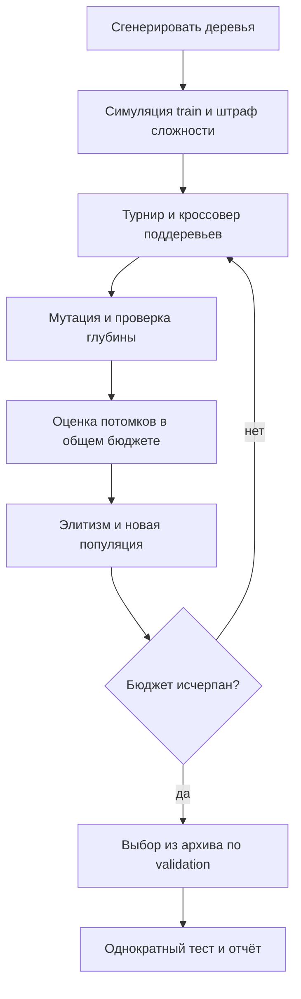

# Отчёт по лабораторной работе №3

Группа **517**, номер в списке **18**, вариант **20**. [Методические указания](https://docs.google.com/document/d/1yAlTbZGFGEu4ww2wHcwsvXlZOYQTkUbYLDp3l8Rfnko/edit).

Соответствие требованиям к отчёту:

| Пункт ТЗ | Где раскрыт |
|---|---|
| 1. Постановка и вариант | Заголовок, раздел "Постановка и данные" |
| 2. Пространство, цель, ограничения | Раздел "Представление и целевая функция", описание допустимых назначений |
| 3. Генотип, фенотип, декодирование | Там же, пошаговый численный пример |
| 4–5. Алгоритм, параметры, блок-схема | Раздел "Эволюционный алгоритм" |
| 6. Обоснование операторов | Таблица после блок-схемы |
| 7–8. Серии и статистика | Раздел "Эксперимент и честность бюджета" |
| 9. Влияние сложности | Раздел "Соответствие треку B" и численный критерий выбора программы |
| 10. Оценка качества результата | Раздел "Вывод и ограничения", отдельная оценка приемлемости |

## Постановка и данные

Нужно построить компактное правило назначения задач неоднородным исполнителям. Каждый сценарий содержит 24 задач и 5 агентов. Для задачи заданы время поступления `r`, объём `w`, срок `d`, навык `s`; агент имеет скорость `v`, стоимость единицы времени `c` и набор навыков. Задачи назначаются в порядке поступления, каждый агент исполняет очередь без прерываний. Допустим только агент с нужным навыком; агент 0 владеет всеми навыками, поэтому допустимое назначение существует. Начало задачи — максимум её поступления и окончания предыдущей задачи агента. Работы не делятся и не исполняются параллельно одним агентом.

Синтетические данные: скорость равномерна на [0.7,1.8], цена на [0.6,2], работа на [1,8], интервалы поступления на [0.1,1], резерв до срока на [6,16]. Каждый агент, кроме универсального, имеет два из трёх навыков. Seed данных `3201800`; разделение: 4 train, 4 validation, 10 test, непересекающиеся seed с отступами 0, 1000, 2000. Полные входные данные: [scenarios.json](../data/scenarios.json). Это учебная модель, а не измерения реальной системы.

## Представление и целевая функция

Генотип — дерево выражения глубиной до 4 (не более 31 узла); фенотип — функция приоритета агента. Для каждого допустимого агента вычисляется выражение, выбирается минимальное значение, при равенстве — меньший индекс агента.

Терминалы: `finish` — прогноз окончания /50; `duration` — прогноз длительности /10; `late` — прогноз опоздания /10; `cost` — прогноз стоимости /10; `load` — прогноз ожидания /20; `slack` — резерв до срока /20. Константы: 0.25, 0.5, 1, 2. Бинарные функции: `add`, `sub`, `mul`, `div`, `min`, `max`. В `div(a,b)` при |b|<0.05 возвращается a. Результаты функций ограничиваются диапазоном [−1000,1000].

Стоимость одного сценария `L = makespan + 4·mean_tardiness + 0.05·total_cost`. Качество — `Q = mean(L) + 0.0·std_population(L)` по набору сценариев. Минимизируется обучающий фитнес `F = Q + 0.2·nodes`. Это явно выбранная свёртка времени, опозданий и расходов; конфликт качества со сложностью показан отдельно. Выигрыш качества может требовать более длинной программы, штраф ограничивает разрастание.

### Пошаговый пример декодирования

Генотип выбранной модели: `finish`, число узлов `1`. `compile_rule` рекурсивно превращает узлы в вычислимую функцию приоритета. Эта функция и есть фенотип-политика; симулятор применяет её к задачам и получает предметное расписание. Генотип, политика и расписание связаны преобразованием, но не являются одним и тем же представлением.

Возьмём первую задачу первого тестового сценария, seed `3203800`. Поступление `0.4413`, работа `2.0036`, срок `12.6575`, навык `2`. Очереди ещё пусты: прогноз длительности равен `work/speed`, прогноз окончания `release+duration`. Терминалы нормируются так, как указано выше; например `finish=прогноз_окончания/50`.

| Допустимый агент | Скорость | Прогноз длительности | Прогноз окончания | Приоритет программы | Выбран |
|---|---:|---:|---:|---:|---|
| 0 | 0.8501 | 2.3568 | 2.7980 | 0.055960 |  |
| 1 | 1.2869 | 1.5568 | 1.9981 | 0.039962 |  |
| 2 | 1.3175 | 1.5207 | 1.9619 | 0.039239 |  |
| 3 | 1.5681 | 1.2777 | 1.7190 | 0.034379 |  |
| 4 | 1.5928 | 1.2579 | 1.6991 | 0.033982 | да |

Минимальный приоритет получил агент `4`. Его строка расписания: задача 0, начало `0.4413`, окончание `1.6991`. Пример проверен сравнением с симулятором и сохранён в [decoding_example.csv](decoding_example.csv). Для остальных задач повторяется тот же процесс с учётом прогнозных очередей. Наличие синтаксически корректной программы гарантируется языком и операторами; качество расписания определяется экспериментом.

## Эволюционный алгоритм

Популяция 32, турнир 3, элитизм 1. Инициализация — grow: терминал с вероятностью 0.3, иначе случайный оператор с двумя потомками; на пределе глубины только терминал. Кроссовер поддеревьев с вероятностью 0.85, мутация поддерева с вероятностью 0.35. Недопустимо глубокий кроссовер отклоняется, глубина мутации ограничена оставшимся уровнем. Деревья синтаксически корректны по построению. Параметры и критерий остановки: [config.json](config.json).

Турнир не требует масштабирования фитнеса; поддеревья сохраняют структуру языка, в отличие от вещественного кроссовера. Разделение train/validation/test снижает переобучение, архив по числу узлов сохраняет различные уровни сложности. Для выбора модели используется только validation + штраф; результаты test не возвращаются в эволюцию.

### Обоснование операторов относительно структуры программы

| Механизм | Почему подходит дереву программы | Ограничение |
|---|---|---|
| Grow-инициализация | Создаёт выражения разных форм и размеров, а не одинаковые полные деревья | Ограничена глубиной конфигурации |
| Турнир размера 3 | Сравнивает F напрямую, без масштабирования и требования положительного фитнеса | Слишком сильный отбор мог бы уменьшить разнообразие; его сила отдельно не исследовалась |
| Кроссовер поддеревьев | Переносит целое вычислимое выражение между программами | Все функции бинарные; если глубина превышена, сохраняется родитель |
| Мутация поддерева | Может менять и признак, и оператор, и форму правила | Глубина нового фрагмента не превышает 2 и оставшуюся допустимую глубину |
| Защищённое деление | Не допускает деления на ноль в произвольных потомках | При модуле знаменателя меньше 0.05 возвращается числитель |
| Элитизм | Сохраняет лучшее обучающее F при вариации | Не гарантирует улучшения на новых сценариях |
| Штраф 0.2 на узел | Задаёт явную цену усложнения и ограничивает разрастание | Более длинное дерево принимается только при достаточном снижении Q |
| Выбор по validation | Отделяет поиск на train от выбора итоговой программы | Test применяется после выбора, без последующего подбора по нему |

Например, в `add(finish, cost)` можно заменить лист `cost` на `min(duration, load)`. Получится корректное бинарное выражение глубины 2. Оно допустимо для предельной глубины 2 или 4, но такой кроссовер был бы отклонён для глубины 1. Корректность не означает улучшения F: это проверяет оценка потомка.

## Соответствие треку B

Вариант 20: синтез стратегии распределения задач между агентами. Эволюционирует структура программы, а не только числовые параметры. Механизмы, отсутствовавшие в ЛР1–ЛР2: симуляционный фитнес и рекомбинация/мутация поддеревьев.

Сравниваются три предельные глубины дерева: 1, 2 и 4. Остальные параметры одинаковы. Ниже показаны три эволюционировавшие программы различной сложности: для каждой сложности выбрана лучшая на validation, test при выборе не используется. Сложная модель может оказаться хуже простой — это результат исследования, а не ошибка отбора.

Во всех конфигурациях валидационный выбор с текущим штрафом предпочёл одноузловую программу `finish`. Увеличение разрешённой глубины не улучшило выбранную политику. Это приемлемый результат автоматического упрощения, но на данном экземпляре польза сложных программ не подтверждена. Архивные программы ниже показывают, почему требуется сравнивать не только выразительность, но и фактическое отложенное качество.

## Эксперимент и честность бюджета

20 независимых запусков каждого метода, seed `3180000`…`3180019`. Все методы получают одинаковые сценарии. Остановка после ровно 480 обучающих оценок, каждая включает 4 симуляции; кеширования нет, оценка элиты повторно не выполняется. Валидация выполняется отдельно для не более 31 размера архива; её число записано в runs.csv и не скрыто в обучающем бюджете. Тест выбранной модели — 10 симуляций; тест не используется для поиска. Ручные правила не обучаются и оценены на тех же 10 тестовых сценариях.

| Метод | Запусков | Лучшее Q | Среднее Q | Медиана | Ст. откл. | Худшее Q | Средние узлы | Время поиска, с |
|---|---:|---:|---:|---:|---:|---:|---:|---:|
| GP_depth_1 | 20 | 34.374 | 34.374 | 34.374 | 0.000 | 34.374 | 1.00 | 0.090 |
| GP_depth_2 | 20 | 34.374 | 34.374 | 34.374 | 0.000 | 34.374 | 1.00 | 0.104 |
| GP_depth_4 | 20 | 34.374 | 34.374 | 34.374 | 0.000 | 34.374 | 1.00 | 0.133 |

Меньше Q — лучше. [Все запуски](runs.csv), [сводка](summary.csv), [траектории](convergence.csv).

### Как читать статистику и одинаковые результаты

Основная таблица содержит **Q на test без штрафа сложности**. Во время эволюции минимизируется **F на train со штрафом**. Размеры деревьев показаны отдельно: складывать Q из таблицы с числом узлов без коэффициента нельзя. Время поиска включает обучающие оценки и выбор по validation; 10 контрольных test-симуляций выполняются отдельно.

Во всех 60 запусках итоговая выбранная программа равна `finish`. Поиски используют разные seed, но их выбранные политики одинаковы. Они проверяются на одном наборе test, поэтому Q совпало точно и стандартное отклонение между запусками равно нулю. Это не нулевой разброс между задачами или сценариями и не отсутствие случайности в самом поиске.

Каждый запуск расходует 480 обучающих оценок, то есть 1920 симуляций train. Тестовые оценки не использовались при выборе программы. Все результаты записаны в runs.csv, включая отдельное число validation-оценок.

### Почему выбрана компактная программа

| Представитель | Узлов | Q validation | Штраф сложности | Критерий выбора Q validation + штраф |
|---|---:|---:|---:|---:|
| compact | 1 | 27.354051 | 0.200000 | 27.554051 |
| medium | 17 | 27.146342 | 3.400000 | 30.546342 |
| complex | 31 | 34.182242 | 6.200000 | 40.382242 |

Выбирается меньший **валидационный критерий со штрафом**, а не меньший Q на test. Поэтому небольшое улучшение чистого Q у более длинной программы может не компенсировать цену её узлов. Таблица позволяет проверить решение отбора численно. Тестовые числа представителей публикуются после выбора; подменять модель по их тестовому рекорду нельзя.

Для каждого метода отдельный файл `convergence_<method>.svg` показывает минимум, среднее и максимум по серии, поэтому разброс не скрыт за лучшей траекторией.

## Сравнение с простыми правилами

| Правило | Q | Время завершения | Среднее опоздание | Стоимость | Опоздавшие |
|---|---:|---:|---:|---:|---:|
| earliest_finish | 34.374 | 25.229 | 0.863 | 113.904 | 8.3% |
| least_cost | 118.489 | 59.192 | 13.814 | 80.859 | 72.5% |
| shortest_duration | 85.901 | 47.953 | 8.273 | 97.142 | 65.8% |

Среднее качество GP_depth_1 совпадает с лучшим ручным правилом. Превосходство эволюции на этом экземпляре не обнаружено. Сравнение относится к фиксированным отложенным сценариям; статистическая значимость и превосходство на всех возможных нагрузках не заявляются. [Данные baseline](baselines.csv).

## Три эволюционировавших решения

| Тип | Узлы | Q validation | Q test | Правило |
|---|---:|---:|---:|---|
| compact | 1 | 27.354 | 34.374 | `finish` |
| medium | 17 | 27.146 | 34.346 | `min(2.0, max(add(min(finish, cost), mul(2.0, finish)), div(max(0.25, cost), sub(load, duration))))` |
| complex | 31 | 34.182 | 41.868 | `add(min(div(div(finish, 2.0), add(0.25, cost)), min(add(0.25, load), min(load, load))), add(div(sub(1.0, duration), add(2.0, finish)), min(div(late, duration), mul(0.25, load))))` |

Компактное правило легче интерпретировать; среднее добавляет условия/взаимодействия признаков; сложное имеет большую выразительность, но риск избыточности и переобучения. В [representatives.json](representatives.json) сохранены сами деревья и происхождение каждого решения. Это представители различных сложностей, а не обещание монотонного роста качества.

Модель для демонстрации: `GP_depth_1`, seed `3180000`, `finish`. Выбрана по validation, а не по тестовому рекорду. [Модель](selected_model.json), [расписание](schedule.csv).

## Вывод и ограничения

### Почему результат приемлем и чего он не доказывает

Показана работоспособность автоматического синтеза программы: задан язык, потомки синтаксически корректны, правило строит допустимые назначения, результаты воспроизводятся. Сравнение глубин проверяет влияние доступной сложности; компактная программа предпочтительна, когда усложнение не окупается по принятому критерию.

Для данного набора найденная политика совпадает по качеству с сильным ручным правилом раннего завершения. Поэтому задача демонстрации синтеза и контроля сложности выполнена, но преимущество эволюционного подхода над этой эвристикой по качеству **не подтверждено**. Ни допустимость назначений, ни нулевой разброс между seed не доказывают глобальный оптимум. Для обоснования практического преимущества нужны другие нагрузки и отдельное исследование переноса.

Лучший по среднему тестовому качеству метод — `GP_depth_1`, среднее Q `34.374`, стандартное отклонение `0.000`. Качество и размер следует рассматривать совместно: штраф 0.2 делает дополнительный узел оправданным только при сопоставимом уменьшении потерь. При равном качестве меньшая программа предпочтительна. Получен работающий и воспроизводимый способ синтеза допустимых назначений с измеренным сравнением ручных правил и разных эволюционных вариантов. Достижение глобального оптимума не доказано.

Ограничения: пять агентов, синтетическое распределение нагрузок, фиксированный порядок очередей, нет перепланирования и зависимостей задач, ограниченный язык, общие для всех запусков тестовые сценарии. Независимость seed поиска характеризует устойчивость алгоритма на этом наборе, а не неопределённость генеральной совокупности. При росте системы потребуется больше сценариев, реальные измерения, проверка чувствительности весов и адаптивное перепланирование. Возможные улучшения: островная модель, сохранение разнообразия семантики и анализ OOD-нагрузок.

