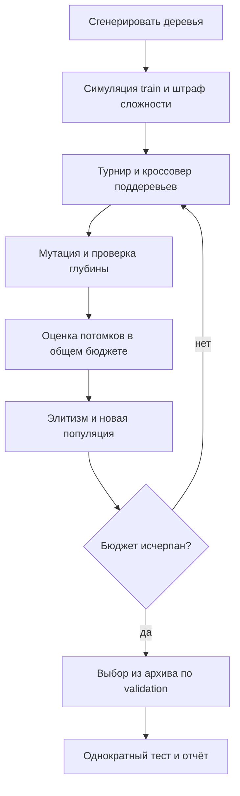
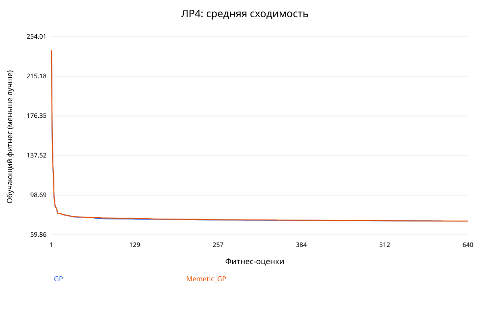
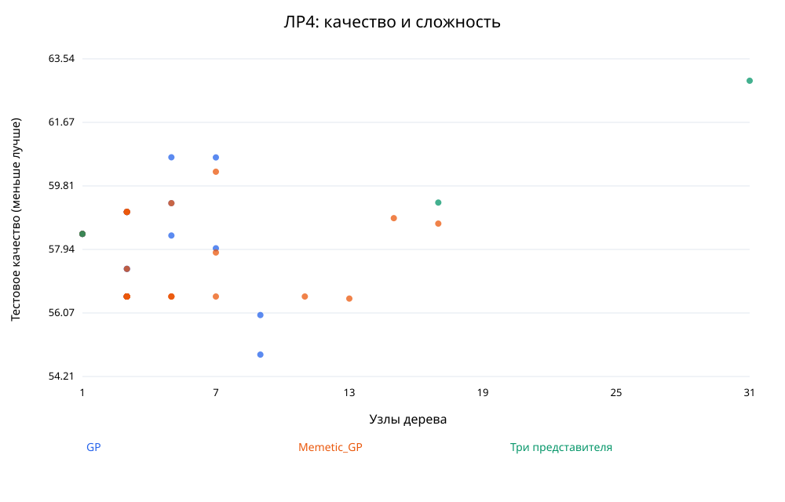
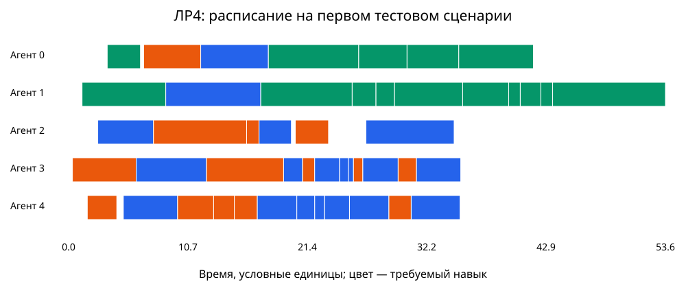

# Отчёт по лабораторной работе №4

Группа **517**, номер в списке **18**, вариант **20**. [Методические указания](https://docs.google.com/document/d/1yAlTbZGFGEu4ww2wHcwsvXlZOYQTkUbYLDp3l8Rfnko/edit).

## Постановка и данные

Нужно построить компактное правило назначения задач неоднородным исполнителям. Каждый сценарий содержит 48 задач и 5 агентов. Для задачи заданы время поступления `r`, объём `w`, срок `d`, навык `s`; агент имеет скорость `v`, стоимость единицы времени `c` и набор навыков. Задачи назначаются в порядке поступления, каждый агент исполняет очередь без прерываний. Допустим только агент с нужным навыком; агент 0 владеет всеми навыками, поэтому допустимое назначение существует. Начало задачи — максимум её поступления и окончания предыдущей задачи агента. Работы не делятся и не исполняются параллельно одним агентом.

Синтетические данные: скорость равномерна на [0.7,1.8], цена на [0.6,2], работа на [1,8], интервалы поступления на [0.1,1], резерв до срока на [6,16]. Каждый агент, кроме универсального, имеет два из трёх навыков. Seed данных `4201800`; разделение: 4 train, 4 validation, 10 test, непересекающиеся seed с отступами 0, 1000, 2000. Полные входные данные: [scenarios.json](../data/scenarios.json). Это учебная модель, а не измерения реальной системы.

## Представление и целевая функция

Генотип — дерево выражения глубиной до 4 (не более 31 узла); фенотип — функция приоритета агента. Для каждого допустимого агента вычисляется выражение, выбирается минимальное значение, при равенстве — меньший индекс агента.

Терминалы: `finish` — прогноз окончания /50; `duration` — прогноз длительности /10; `late` — прогноз опоздания /10; `cost` — прогноз стоимости /10; `load` — прогноз ожидания /20; `slack` — резерв до срока /20. Константы: 0.25, 0.5, 1, 2. Бинарные функции: `add`, `sub`, `mul`, `div`, `min`, `max`. В `div(a,b)` при |b|<0.05 возвращается a. Результаты функций ограничиваются диапазоном [−1000,1000].

Стоимость одного сценария `L = makespan + 4·mean_tardiness + 0.05·total_cost`. Качество — `Q = mean(L) + 0.5·std_population(L)` по набору сценариев. Минимизируется обучающий фитнес `F = Q + 0.2·nodes`. Это явно выбранная свёртка времени, опозданий и расходов; конфликт качества со сложностью показан отдельно. Выигрыш качества может требовать более длинной программы, штраф ограничивает разрастание.

## Эволюционный алгоритм

Популяция 32, турнир 3, элитизм 1. Инициализация — grow: терминал с вероятностью 0.3, иначе случайный оператор с двумя потомками; на пределе глубины только терминал. Кроссовер поддеревьев с вероятностью 0.85, мутация поддерева с вероятностью 0.35. Недопустимо глубокий кроссовер отклоняется, глубина мутации ограничена оставшимся уровнем. Деревья синтаксически корректны по построению. Параметры и критерий остановки: [config.json](config.json).

Турнир не требует масштабирования фитнеса; поддеревья сохраняют структуру языка, в отличие от вещественного кроссовера. Разделение train/validation/test снижает переобучение, архив по числу узлов сохраняет различные уровни сложности. Для выбора модели используется только validation + штраф; результаты test не возвращаются в эволюцию.

## Исследовательское расширение и сравнение

Вариант 20: собственная прикладная задача. До основной реализации подготовлена [заявка](../PROPOSAL.md). Подтверждение утверждения преподавателем не предоставлено; программная готовность не заменяет этого условия.

По сравнению с ЛР3 число задач увеличено с 24 до 48, фактические длительности имеют независимые логнормальные множители со стандартным отклонением логарифма 0.35 и средним множителем 1. Политика видит только прогнозируемые признаки. Фактическая длительность применяется в симуляторе после назначения, недоступна при выборе агента и не просачивается в прогноз.

Сравниваются GP и Memetic_GP с одинаковыми начальными seed, популяцией, глубиной, штрафом и общим бюджетом. Меметический вариант с вероятностью 0.4 проверяет одну локальную мутацию потомка и принимает улучшение; каждая такая проверка расходует один общий фитнес-вызов. Поэтому локальный поиск получает часть бюджета вместо части обычных потомков. Превосходство меметического метода не предполагается заранее.

## Эксперимент и честность бюджета

30 независимых запусков каждого метода, seed `4180000`…`4180029`. Все методы получают одинаковые сценарии. Остановка после ровно 640 обучающих оценок, каждая включает 4 симуляции; кеширования нет, оценка элиты повторно не выполняется. Валидация выполняется отдельно для не более 31 размера архива; её число записано в runs.csv и не скрыто в обучающем бюджете. Тест выбранной модели — 10 симуляций; тест не используется для поиска. Ручные правила не обучаются и оценены на тех же 10 тестовых сценариях.

| Метод | Запусков | Лучшее Q | Среднее Q | Медиана | Ст. откл. | Худшее Q | Средние узлы | Время поиска, с |
|---|---:|---:|---:|---:|---:|---:|---:|---:|
| GP | 30 | 54.851 | 57.523 | 56.558 | 1.410 | 60.649 | 3.67 | 0.403 |
| Memetic_GP | 30 | 56.497 | 57.524 | 56.558 | 1.215 | 60.225 | 5.00 | 0.460 |

Меньше Q — лучше. [Все запуски](runs.csv), [сводка](summary.csv), [траектории](convergence.csv).

Для каждого метода отдельный файл `convergence_<method>.svg` показывает минимум, среднее и максимум по серии, поэтому разброс не скрыт за лучшей траекторией.

## Сравнение с простыми правилами

| Правило | Q | Время завершения | Среднее опоздание | Стоимость | Опоздавшие |
|---|---:|---:|---:|---:|---:|
| earliest_finish | 58.371 | 40.384 | 0.663 | 208.899 | 16.7% |
| least_cost | 270.561 | 111.523 | 30.462 | 133.554 | 84.4% |
| shortest_duration | 266.197 | 104.374 | 28.452 | 170.462 | 82.9% |

Среднее качество GP лучше лучшего ручного правила на 1.45%. Сравнение относится к фиксированным отложенным сценариям; статистическая значимость и превосходство на всех возможных нагрузках не заявляются. [Данные baseline](baselines.csv).

## Три эволюционировавших решения

| Тип | Узлы | Q validation | Q test | Правило |
|---|---:|---:|---:|---|
| compact | 1 | 62.437 | 58.397 | `load` |
| medium | 17 | 57.788 | 59.318 | `mul(add(add(load, 0.25), 2.0), max(add(mul(1.0, late), 0.5), sub(min(0.5, late), late)))` |
| complex | 31 | 66.938 | 62.898 | `mul(min(add(mul(0.5, slack), add(0.25, load)), mul(div(cost, 1.0), add(load, 1.0))), add(min(add(load, slack), sub(load, duration)), sub(add(load, load), sub(duration, finish))))` |

Компактное правило легче интерпретировать; среднее добавляет условия/взаимодействия признаков; сложное имеет большую выразительность, но риск избыточности и переобучения. В [representatives.json](representatives.json) сохранены сами деревья и происхождение каждого решения. Это представители различных сложностей, а не обещание монотонного роста качества.

Модель для демонстрации: `GP`, seed `4180011`, `add(min(load, duration), finish)`. Выбрана по validation, а не по тестовому рекорду. [Модель](selected_model.json), [расписание](schedule.csv).

## Вывод и ограничения

Лучший по среднему тестовому качеству метод — `GP`, среднее Q `57.523`, стандартное отклонение `1.410`. Качество и размер следует рассматривать совместно: штраф 0.2 делает дополнительный узел оправданным только при сопоставимом уменьшении потерь. При равном качестве меньшая программа предпочтительна. Получен работающий и воспроизводимый способ синтеза допустимых назначений с измеренным сравнением ручных правил и разных эволюционных вариантов. Достижение глобального оптимума не доказано.

Ограничения: пять агентов, синтетическое распределение нагрузок, фиксированный порядок очередей, нет перепланирования и зависимостей задач, ограниченный язык, общие для всех запусков тестовые сценарии. Независимость seed поиска характеризует устойчивость алгоритма на этом наборе, а не неопределённость генеральной совокупности. При росте системы потребуется больше сценариев, реальные измерения, проверка чувствительности весов и адаптивное перепланирование. Возможные улучшения: островная модель, сохранение разнообразия семантики и анализ OOD-нагрузок.

Сценарий демонстрации на 6 минут и ответы на вопросы: [DEMO.md](../DEMO.md). Устная защита остаётся действием студента.

